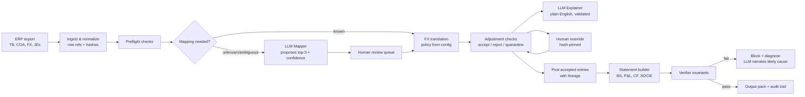

# Architecture: Agentic Financial Statement Generation

**Author:** Ayaan Khan · **Scope:** design for the full feature; prototype of the *manual adjustments* slice
**One-line summary:** a deterministic pipeline that owns every number and every decision, with LLMs used in three narrow roles where judgement or language is needed: mapping proposals, plain-English explanations, and variance narration. Each LLM output is validated by code before it is used.

**How to read this doc:** **[Prototype]** marks what the repo implements and tests today. **[Production]** marks what I recommend for the complete system. Section 11 has the full list.
**Client guidance (reply, 23 Oct):** proceed with safe assumptions, never invent rates or data, flag TB and retained earnings discrepancies, validate entries *and their business purpose*, and document controls and the approval workflow. Sections 4, 7 and 10 address these directly.

---

## 1. Problem decomposition

"Generate financials" is not one problem. It is at least eight, and they need very different levels of reliability:

| # | Sub-problem | Nature | Required reliability | Who does it |
|---|---|---|---|---|
| 1 | Ingest & normalize ERP exports (SAP/NetSuite formats, encodings, signs) | Parsing | Exact | Code |
| 2 | Input validation (TB balances, duplicates, orphans, FX gaps, COA integrity) | Rules | Exact | Code |
| 3 | Map ERP accounts → client COA (new, renamed, ambiguous accounts) | Judgement | High, human-approved | **LLM proposes**, code checks, human approves |
| 4 | FX translation / remeasurement | Arithmetic + policy | Exact, policy set by client | Code (policy is config, not inference) |
| 5 | Manual adjustments: validate, accept/reject/quarantine | Rules | Exact | Code decides |
| 6 | Explain rejections / holds to finance users | Language | Must be faithful to facts | **LLM writes**, code validates |
| 7 | Intercompany matching & elimination | Matching + rules | Exact | Code; LLM only to suggest probable matches |
| 8 | Build BS, P&L, CF (indirect), SOCIE | Arithmetic | Exact | Code |
| 9 | Verify statements (BS balances, NI → RE, CF → cash movement, ties to TB) | Invariants | Exact | Code |
| 10 | Variance / reconciliation commentary ("why did X change?") | Language + analysis | Faithful to facts | **LLM narrates** deltas that code computed |

The pattern: **anything that produces a number is code. Anything that needs judgement about meaning or needs to talk to a human can use an LLM, but only as a proposer.**

## 2. Agent topology

### Choice: deterministic orchestrator + 3 narrow LLM "skills"



**Why not a single agent with tools?** A single agent that "decides what to do next" puts the control flow in the model, and here the control flow is fixed and known. Finance needs the same inputs to give the same outputs every time (idempotency), and a model choosing its own tool order makes that hard to guarantee and hard to audit.

**Why not an orchestrator with 5+ sub-agents (Mapper, Adjuster, Builder, Validator…)?** Most of those "agents" would be doing arithmetic or rule checks, and an LLM adds cost, latency and risk there without any benefit. The brief itself calls a 12-agent swarm a red flag, and I agree. The Validator in particular must **not** be an LLM, because a model grading another model's arithmetic is not a control.

**What I do use:** a plain-code pipeline (a DAG) with three LLM calls at points where judgement or language is unavoidable:

1. **Mapper:** for accounts that rules can't map (new code, rename, free-text name). It returns a ranked list of candidates *from the COA only*, each with a confidence score and a reason. It cannot invent accounts.
2. **Explainer:** turns structured findings into a note a finance user can act on.
3. **Narrator:** for reconciliation and variance commentary, and for diagnosing why a verifier check failed. It describes deltas that code already computed.

Each LLM call is a pure function with a typed input, a typed output and a validator. None of them can write to the ledger.

## 3. The line between deterministic code and LLM reasoning

| Decision | Code or LLM | Why |
|---|---|---|
| Does the entry balance? Is the account in the COA? Is the date in period? | Code | Binary facts. An LLM can only add error. |
| Accept / reject / quarantine | Code | It is a control, and controls must be deterministic and testable. |
| FX rate to apply | Code + client config | This is an accounting *policy* (ASC 830 remeasurement vs translation). It is set once by the client and never inferred per run. |
| Which COA node does "Sundry Operating Expenses" (6905) belong to? | **LLM proposes** → human approves → stored as a versioned mapping | Semantic matching across ERP naming styles is where models genuinely beat rules. |
| Why was JE-002 rejected, in words a controller understands | **LLM** (validated) | Language. |
| Why did Accrued Expenses rise 925k? | Code computes the deltas, **LLM** writes the narrative | Code guarantees the numbers; the LLM explains them. |
| Statement totals, subtotals, CF lines | Code | Arithmetic. |

**Where the AI earns its keep:** in the long tail of messy, client-specific semantics (mappings, renamed accounts, ambiguous categories) and in communication (explanations, commentary). That is where finance teams actually spend their close-week hours. It does not earn its keep in adding up a TB.

## 4. Failure modes and how each is handled

| Failure mode | Seen in data | Handling | Status |
|---|---|---|---|
| **Hallucinated account mapping** | 6315, 9999, 6905 | The LLM can only choose from COA codes, and its output is schema-checked. A mapping is never auto-applied for posting. Approved mappings are stored and versioned, and when one is applied the entry is **re-validated**. | ✅ Mapping 6315→6310 is caught as circular on re-check |
| **Debits ≠ credits after adjustments** | JE-002 (3,500) | Hard ERROR → rejected. This cannot be overridden and must be fixed at source. The system never guesses which side is wrong. A posting invariant re-checks the total before any output is written. | ✅ |
| **Account fits no COA node** | 9999 Suspense | Quarantine with "no credible candidate". Recommend investigating the underlying transactions. Never auto-assign. | ✅ |
| **FX gaps** | GBP has no period-end rate | Block translation of that currency. Never fall back silently to the average or the last rate. Report which statement lines are affected. | ✅ diagnostics |
| **FX amounts that don't recompute** | JE-003: 11,200 vs 10,730.20 | Recompute from the TB and the rate table. On a mismatch → quarantine and show the workings. Also flag the risk of double counting if the TB is translated at period-end anyway. | ✅ |
| **Circular intercompany entry** | JE-008 (2170 vs 2170) | Every line nets to zero on the same account → reject. The COA also has no IC counterparty account, so elimination is impossible → flag. | ✅ |
| **Duplicate TB rows** | 6310 ×2 | Keep both rows (they could be a genuine split), flag them, and require confirmation. Silent dedup would lose 38,500 if the split is real. | ✅ |
| **TB doesn't balance** | Current −4,800 raw; prior 2.83M | Report raw and translated differences per rate type. The differences (−338,687 at period-end, GBP excluded; +171,730 at average) are far too large to be "FX rounding", so the cause is basis or policy, not rounding. | ✅ |
| **Retained earnings roll-forward break** | 5.18M → 7.24M, P&L still open | Hold and ask (dividend? restatement? partial close?). SOCIE cannot be built until this is resolved. | ✅ diagnostics |
| **COA structural ambiguity** | 1290 empty header; 3300/8000 non-header parents; 7000 no normal balance; 1150/2170 cf = TBD | Flagged before the build. The CF builder refuses accounts with a TBD category. Sign logic uses `normal_balance`, never the account type (contra accounts: 1121, 1211, 1221, 4200, 3400). | ✅ diagnostics |
| **Material manual entries** | JE-001 (850k > 340k threshold) | **Held** until an approver other than the preparer signs off; then re-checked and posted. | ✅ Prototype (approval via `overrides.json`) |
| **Business purpose doesn't fit the accounts** | JE-008 "settlement" touches only 2170 | Classify the entry from its description (accrual, depreciation, provision, FX reval, tax, reclass, settlement) and check the accounts fit that type. A mismatch → hold for review. An unrecognised description → reviewer must confirm. | ✅ Prototype (rule-based). [Production] an LLM reads the supporting memo/workbook and flags inconsistencies; it never decides. |
| **No supporting evidence** | (none in batch) | An entry without a source/workpaper reference is held. | ✅ Prototype |
| **LLM failure / timeout** | n/a | The decision is never blocked: code has already decided, and the explanation falls back to a template. | ✅ tested |

### 4.1 Scenario decisions on the provided batch

| Entry | Business purpose check | Decision | Why | Next step / who |
|---|---|---|---|---|
| JE-001 Bonus accrual 850,000 | Accrual: Dr expense, Cr liability ✓ | ⚠️ Quarantined | Above materiality (340,325) | Controller reviews workbook v3 and approves → posted (shown in `output/hitl_demo/`) |
| JE-002 Marketing reclass | Reclass: expense to expense ✓ | ❌ Rejected | Dr 28,500 ≠ Cr 25,000 | Preparer corrects and resubmits; cannot be overridden |
| JE-003 EUR FX reval 11,200 | FX reval: BS + FX account ✓ | ⚠️ Quarantined | Recomputes to 10,730.20; double-count risk | Treasury provides workings; Controller acknowledges or rejects |
| JE-004 Bad debt provision | Provision: Dr expense, Cr allowance ✓ | ✅ Accepted | All checks passed | — |
| JE-005 Conference travel | Reclass ✓ (known side) | ⚠️ Quarantined | 6315 not in COA; best match 6310 would self-offset | COA owner creates the account or preparer corrects the code. The demo shows a wrong mapping being caught |
| JE-006 Depreciation | Dr Depreciation Expense, Cr Accum. Dep. ✓ | ✅ Accepted | All checks passed | — |
| JE-007 Deferred tax | Both sides tax accounts ✓ | ✅ Accepted | All checks passed | — |
| JE-008 IC settlement | Settlement: needs cash/counterparty ✗ | ❌ Rejected | Circular (2170 vs 2170); no IC counterparty in COA | Preparer identifies the real counterparty; IC team confirms with the UK sub |
| JE-009 Legal accrual | Accrual ✓ | ✅ Accepted | All checks passed | — |
| JE-010 LT debt reclass | Reclass: liability to liability ✓ | ✅ Accepted | All checks passed | — |

Result: **5 accepted, 3 quarantined, 2 rejected.** Posted adjustments total 573,000 (Dr = Cr).

## 5. Validation and self-correction loop

**Before an LLM output is used:**

1. It must be valid JSON matching the schema.
2. **Every number in the text must already exist in the facts.** This blocks invented amounts.
3. It must not contradict the code's decision (e.g., saying "posted" for a rejected entry).
4. For the Mapper, every proposed code must exist in the COA and be a leaf.

**If a check fails:** one retry, with the validator's errors fed back to the model. If it fails again, the system uses a deterministic template and records `explanation_source: template_fallback` in the audit log. Retries are bounded, so the loop can never run indefinitely.

**Before any statement is returned (verifier invariants):**

- Posted adjustments: total Dr = total Cr, and they equal the total of the accepted entries.
- Every posted line hits an existing leaf account.
- No TB row was lost or duplicated during posting.
- *(full system)* Assets = Liabilities + Equity; P&L net income = movement in retained earnings (SOCIE); closing cash on the CF = cash on the BS; every statement line = the sum of its mapped TB lines; current-period comparatives = prior closing.

**If an invariant fails:** stop. No partial output is written. The diagnosis (which invariant, by how much, which accounts) goes to the Narrator, which writes a likely-cause note for a human. **The system never "corrects" a number on its own to make an invariant pass.** Self-correction is allowed for *formatting and wording*. It is never allowed for *amounts*.

## 6. Audit traceability: from any cell back to source

Every object carries a stable ID, and the path from a cell back to source is fully linked:

```
Statement cell ─▶ statement line (rule id, COA version)
               ─▶ post-adjustment TB lines (account, currency)
               ─▶ source rows:  trial_balance.csv:19  (file sha256)
                                JE-001#L2  (entry content_hash, approver if overridden)
               ─▶ mapping decision (who approved, when, mapping version)
               ─▶ FX rate used (rate table row, policy id)
```

The prototype implements this down to row level. After the Controller approves JE-001, `adjagent trace 2120 --overrides examples/overrides.example.json` prints:

```
2120 Accrued Expenses [USD]  post-adjustment net -2,075,000.00 (debit-positive)
  <- trial_balance.csv:19   TB row      Cr 1,150,000.00
  <- JE-001#L2              JE-001 adj  Cr   850,000.00  'Accrue Q4 bonus pool' (source: bonus accrual workbook v3)
  <- JE-009#L2              JE-009 adj  Cr    75,000.00  'Accrue legal fees…' (source: Legal memo 2024-12-29)
```

In the full system:

- Lineage is stored as an append-only event log (`run_log.jsonl` today; a table in production).
- Each run is identified by `run_id = hash(input files + config + overrides + code version)`, so an auditor can reproduce any historical output exactly.
- **Limit:** a TB is already an aggregate. Tracing below the TB row (to invoices, bills) needs a GL detail extract from the ERP. That should be an ingestion requirement, not an afterthought (see the reflection).

## 7. Controls and human approval workflow

**Entry lifecycle**

```
Submitted -> automated checks -> REJECTED     -> back to preparer (hard error, cannot be overridden)
                              -> QUARANTINED  -> reviewer queue -> approve with reason -> re-checked -> posted
                                                                -> send back to preparer
                              -> ACCEPTED     -> posted with lineage
```

**Approval matrix** *(roles are a recommendation; the client confirmed a Controller-level approver)*

| Situation | Who can resolve it | Prototype | Production |
|---|---|---|---|
| Unbalanced / circular / wrong period (ERROR) | Nobody can override. Preparer must fix and resubmit | ✅ | same |
| Material entry (> materiality) | Controller, and never the preparer of the entry | ✅ via `acknowledge_rules` | Four-eyes approval in a review UI; approver ≠ preparer enforced |
| Account not in COA | COA owner (create the account) or preparer (correct the code); mapping approved by Controller | ✅ via `account_mapping`, then re-check | Versioned mapping memory reused across periods |
| FX amount doesn't recompute / missing rate | Treasury provides workings or rate; Controller acknowledges | ✅ | FX rates pulled from an approved source with policy id |
| Business purpose mismatch / unverified | Reviewer confirms purpose against the supporting document | ✅ | LLM pre-reads the support and highlights inconsistencies for the reviewer |
| TB / retained earnings discrepancies | Controller / ERP owner explains before statements are built | ✅ flagged in diagnostics | Statement build blocked until resolved |

**Control properties (all implemented and tested):**

- **Hash-pinned approvals:** an override names `entry_id` + `content_hash` + `approver` + `reason`. If the entry changes after approval, the approval is ignored.
- **ERRORs can never be overridden.** Only HOLDs can be acknowledged, and only by a named approver with a reason.
- **Re-validation after every human change:** in `output/hitl_demo/` the approver maps 6315→6310. The system re-checks the entry and **rejects** it, because it now debits and credits 6310 for the same amount. The human made a plausible but wrong call, and the control caught it.
- **Audit record:** every decision stores the initial decision, the findings, the override (who, why, what changed) and the final decision.

## 8. Idempotency and versioning

- Same inputs + config + overrides + code version → same `run_id` → byte-identical decisions and TB (this is tested).
- Money is `Decimal`, never float.
- COA, mapping table and FX policy are versioned inputs, not mutable global state.
- Re-running after a fix creates a new run, and the old run stays reproducible.

## 9. How the four statements would be built (design, not prototyped)

- **P&L:** sum of PL accounts by COA hierarchy, using signs from `normal_balance`. Period basis (YTD vs QTD) is confirmed with the client.
- **Balance Sheet:** BS accounts at closing. Current-period profit is shown via retained earnings, or as "current year earnings" in a pre-closing TB.
- **SOCIE:** opening equity (from the prior TB) + net income + OCI (FX translation reserve) + transactions with owners (dividends, buybacks via treasury stock) = closing equity. **Currently blocked** by the 2.06M unexplained RE movement.
- **Cash flow (indirect):** net income + non-cash items (depreciation, amortization, unrealized FX, disposal gains, bad debt) ± working capital movements (current vs prior BS, by `cf_category`) ± investing/financing movements. This needs a complete prior BS and **no TBD categories**, so it is currently blocked by 1150 and 2170.

## 10. Assumptions and unresolved questions

The client replied that I should proceed with safe assumptions. These are the ones used, and the questions that stay open:

1. Adjustments are in USD (as stated in the batch); TB foreign rows are in local currency. *Open:* FX basis confirmation.
2. The materiality threshold is 5% of pre-tax income (6,806,500 → 340,325). The audit team would set the real one.
3. A missing FX rate blocks; no fallback is applied.
4. Duplicate TB rows are kept and flagged, not merged or dropped.
5. The P&L period basis is not inferred; it is flagged as an open question.
6. *Open:* the 2.06M retained earnings movement and the unbalanced prior TB. Both are flagged; statements that depend on them stay blocked.
7. *Open:* JE-008's real counterparty. It is rejected until the preparer provides it.
8. Approver for held entries = Controller (confirmed as the expected role).

## 11. What the prototype builds vs what is designed only

| Component | Prototype | Notes |
|---|---|---|
| Ingest with row refs, file hashes | ✅ Built | |
| Preflight diagnostics (TB, COA, FX, prior TB) | ✅ Built | 23 issues found |
| Adjustment rules + accept / reject / quarantine | ✅ Built | |
| Business-purpose check (description vs accounts) + supporting-evidence check | ✅ Built | Rule-based. An LLM review of supporting documents is a [Production] recommendation |
| Approval workflow (materiality hold, approver + reason, hash-pinned) | ✅ Built | File-based (`overrides.json`). [Production]: review UI with enforced approver ≠ preparer |
| LLM Explainer with number/decision validation, retry, fallback | ✅ Built | Tested with fake LLMs; works with OpenAI or Gemini |
| Human overrides (hash-pinned, re-validated) | ✅ Built | `output/hitl_demo/` |
| Posting with lineage + invariants + `trace` command | ✅ Built | |
| Mapper | ⚠️ Partial | Deterministic candidate scoring (name + code proximity) only. The LLM re-ranking step is designed, not built. |
| FX translation, statement builder, CF, SOCIE | ❌ Design only | Blocked anyway by open client questions (FX basis, RE gap, TBD categories) |
| Narrator (variance commentary) | ❌ Design only | |
| Review UI, mapping memory, multi-entity | ❌ Design only | See reflection |

## 12. Scaling notes

The scaling discussion (thousands of accounts, multi-entity consolidation, mapping memory across periods and clients) is in `docs/reflection.md`.
